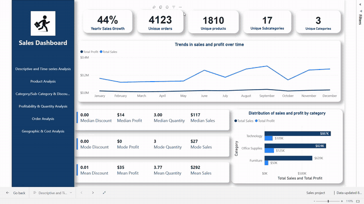
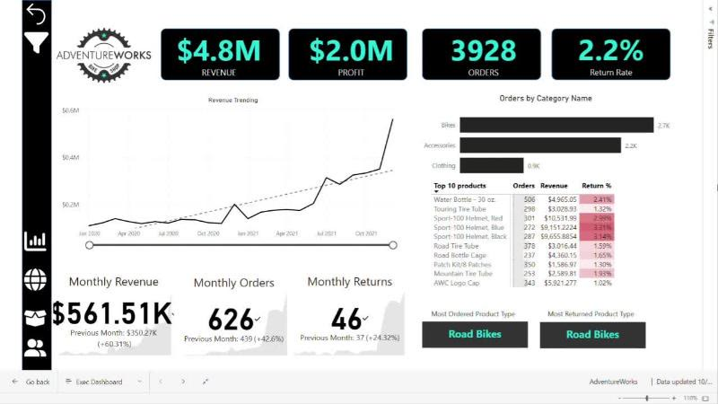

  

  
  
  
  

## 👋 About me

I'm a **Business Intelligence Analyst** in Jeddah who turns messy, multi-source data into Power BI reports that people actually use.

- 📊 **Data Analyst at SDC App**: Power BI dashboards for every department, which raised **reporting efficiency by 80%** and **adoption by 40%**
- 🔐 Row-Level Security, data quality checks and monthly/quarterly KPI reviews with department leads
- 🏢 Before that, **Junior Data Analyst at BM Enterprise Management**: benchmarked KPIs across **100+ insurance companies** and cut paper costs by 30%
- 🎓 **B.Sc. Data Science**, Alexandria University (2023). Graduation project: real-time Egyptian Sign Language translation
- 🌍 Arabic (native) · English (professional)

## 🎬 Featured projects

<table>
  <tr>
    <td width="33%" valign="top">
      
      <h3><a href="https://github.com/saraismailali/Egyptian-Sign-Language-Recognition-Using-Machine-Learning">Egyptian Sign Language Recognition</a></h3>
      Real-time sign language to Arabic text: a CNN for 32 letters (<b>90.5%</b>) and an LSTM for railway-station words (up to <b>92.7%</b>), with a live webcam app.
        
      <code>TensorFlow</code> <code>LSTM</code> <code>MediaPipe</code>
        
      <a href="https://www.linkedin.com/feed/update/urn:li:activity:7078135053704175616/">▶ Watch demo</a> · <a href="https://github.com/saraismailali/Egyptian-Sign-Language-Recognition-Using-Machine-Learning">Code</a>
    </td>
    <td width="33%" valign="top">
      
      <h3><a href="https://sara-portfolio-sable.vercel.app/#projects">Sales &amp; Profitability Analysis</a></h3>
      Cleaned an uncleaned 9-table dataset in Power Query and built a <b>6-page</b> report with <b>50+ DAX measures</b>: trends, discounts, profitability, customer segments and cities.
        
      <code>Power BI</code> <code>DAX</code> <code>Power Query</code>
        
      <a href="https://sara-portfolio-sable.vercel.app/#projects">▶ Watch full video</a>
    </td>
    <td width="33%" valign="top">
      
      <h3><a href="https://github.com/saraismailali/-Adventure-Works-Power-BI-Project">AdventureWorks BI Report</a></h3>
      5-page report on a star-schema model with <b>35+ DAX measures</b>: YTD and rolling totals, KPIs against targets, a what-if price parameter, bookmarks and custom tooltips.
        
      <code>Power BI</code> <code>Time intelligence</code> <code>What-if</code>
        
      <a href="https://www.linkedin.com/feed/update/urn:li:activity:7121575050301878272/">▶ Watch demo</a> · <a href="https://github.com/saraismailali/-Adventure-Works-Power-BI-Project">Code</a>
    </td>
  </tr>
</table>

## 📁 More projects

| Project | What it shows | Tools |
|---|---|---|
| [Sales & Profit Performance Dashboard](https://github.com/saraismailali/Power-BI-SALES-PROFIT-PERFORMANCE-DASHBOARD) | 15K+ transactions from Excel, CSV, PDF and four yearly files; revenue vs targets, YoY growth, discount impact | Power BI · Power Query · DAX |
| [Hotel Revenue Analysis](https://github.com/saraismailali/Hotel-data-analysis-SQL-power-bi-) | 3 years of bookings combined in SQL Server; revenue growth, hotel type, parking demand, seasonality | SQL Server · T-SQL · Power BI |
| [Employee Database Analysis](https://github.com/saraismailali/SQL-employee-data-analysis) | Stored procedures, user-defined functions, CTEs and window functions on a multi-table database | MySQL |
| [Excel Sales, Profit & Quantity Dashboards](https://github.com/saraismailali/Excel-Sales-Profit-Quantity-Dashboards) | 30+ PivotTables on the Data Model with slicers and a timeline; Power Query incl. PDF extraction | Excel · Power Pivot |
| [Twitter Airline Sentiment](https://github.com/saraismailali/Powerbi-project) | Power BI report on SQL Server with DirectQuery for live refresh | Power BI · SQL Server |
| [Walmart Sales Analysis](https://github.com/saraismailali/Walmart-Sales-Analysis-using-sql) | Data cleaning, feature engineering and 10 business questions by branch, product line and customer | SQL |
| [Employee Data Dashboard](https://github.com/saraismailali/Employee-Data-Analysis-using-SQL-and-Tableau) | SQL feeding Tableau views on hiring, managers and salaries by department | SQL · Tableau |
| [Web Scraping: Largest US Companies](https://github.com/saraismailali/Scraping-Data-from-a-Real-Website-Web-Scraping-in-Python) | Scraped a live table of the 100 largest US companies into a clean dataset | Python · BeautifulSoup · pandas |
| [Restaurant Review Sentiment](https://github.com/saraismailali/Nlp-project-using-machine-learning-Sentiment-Analysis) | Text cleaning, bag-of-words and a classifier (74% accuracy) | Python · NLTK · scikit-learn |
| [COVID-19 Detection from X-rays](https://github.com/saraismailali/Data-Tools-Project) | CNN classifying chest X-ray images | Python · TensorFlow |

## 🧰 Toolbox

**Microsoft BI stack** 

**Databases & SQL** 

**Excel & analysis** 

**Python & machine learning** 

## 🏅 Certifications

- [**Microsoft Certified: Power BI Data Analyst Associate (PL-300)**](https://learn.microsoft.com/en-gb/users/saraali-1065/credentials/abde942c36385002), Microsoft, 2025
- [Business Intelligence Analyst Course](https://www.udemy.com/certificate/UC-a10bd0ea-2655-4db0-91ab-740ef59f599c/), 365 Careers, 2024
- [Thinking Like an Analyst](https://certificates.mavenanalytics.io/bdf3a464-f42f-4bcd-895a-388e60e05ca1#acc.704b8Jsk), Maven Analytics, 2024
- [Microsoft Power BI Desktop for Business Intelligence](https://udemy-certificate.s3.amazonaws.com/pdf/UC-a4affd34-e899-4870-89a6-157dea7cb8b2.pdf), Udemy, 2023
- [Foundations of Data Science](https://www.coursera.org/account/accomplishments/verify/Z4FHBEZ4LMSW), Google (Coursera), 2023
- [Business Analytics with Excel](https://www.coursera.org/account/accomplishments/certificate/89BYS4C35HR5), Johns Hopkins University (Coursera), 2023
- [PostgreSQL Essential Training](https://www.linkedin.com/learning/certificates/132b81c0693bfc071f8dc5bd99c9f6a666178be432e41c7cb7b1e7151e90a615), LinkedIn Learning, 2023
- [Databases: Relational Databases and SQL](https://courses.edx.org/certificates/8eaece324b8c4774934ba4be31caa351), edX, 2023
- [Introduction to Databases](https://www.coursera.org/account/accomplishments/certificate/EHCH5UQ5CW8B), Meta (Coursera), 2023
- [Understanding Data Engineering](https://www.datacamp.com/statement-of-accomplishment/course/b32ee40a4fba66e55070bbfa0fd11b316fc0bf4b), DataCamp, 2023
- [Intermediate Importing Data in Python](https://www.datacamp.com/statement-of-accomplishment/course/8736ce0997163ab48916fff85688791ba31ad7f9), DataCamp, 2023
- [Introduction to Programming Using Python](https://drive.google.com/file/d/1r5JebFJ1n9avNRKpwcRdT2AGFyZw5Kqc/view), New Horizons, 2019

---

  <b>Open to Business Intelligence and Data Analyst roles in Saudi Arabia.</b> 
  <a href="https://sara-portfolio-sable.vercel.app/">Portfolio</a> · <a href="https://www.linkedin.com/in/sarrraaali/">LinkedIn</a> · <a href="mailto:saraismail4255@gmail.com">saraismail4255@gmail.com</a>

